# moNa2 v2 (DYA Studio 対応版)

このリポジトリは [moNa2 v2](https://github.com/sayu-hub/zmk-config-moNa2) 用 ZMK Config を、[cormoran](https://github.com/cormoran) さんが公開している **[DYA Studio](https://studio.dya.cormoran.works/)** に対応させたものです。

DYA Studio は ZMK Studio をベースに、

- キーマップ／レイヤーの GUI 編集
- トラックボール (PAW3222) のスクロール量・軸反転・自動マウスレイヤーなど **Runtime Input Processor 経由での動的設定**
- バッテリ履歴の閲覧
- BLE プロファイル管理 / Settings RPC

を Web から行えるようにした拡張版です。

> [!NOTE]
> このフォーク（hirunefu/zmk-config-moNa2-v2）は、右手のトラックボールを **PAW3222 専用**にしています。PMW3610 用のビルドはありません。右手には `mona2_r-paw3222`、左手には `mona2_l` で始まるファイルを書き込みます。

## キーマップ

[keymap-drawer YAML](keymap-drawer/mona2.yaml) / [SVGを開く](keymap-drawer/mona2.svg)

## DYA Studio の使い方

1. 本リポジトリをビルドし、生成された `mona2_r-...uf2`（中央側＝右手）と `mona2_l-...uf2`（周辺側＝左手）をそれぞれの XIAO BLE に書き込みます。
2. 中央側（右手）を **USB ケーブル** で PC に接続します。
3. Chrome / Edge などの WebUSB 対応ブラウザで **[https://studio.dya.cormoran.works/](https://studio.dya.cormoran.works/)** を開きます。
4. キーボード側で `BLE` レイヤー(レイヤー10/11)を有効にし、右下に配置した **`&studio_unlock`** キーを押してアンロック。
5. DYA Studio 側で「Connect」を押し、USB デバイスとして mona2 を選択。
6. キーマップ／トラックボール設定／バッテリ履歴を編集できます。

### このリポジトリで対応済みの内容

| 対応項目 | ファイル / 箇所 |
| --- | --- |
| ZMK 本体を cormoran さんの fork (`v0.3-branch+dya`) に切替 | `config/west.yml` |
| DYA Studio モジュール 4 本を west.yml に追加 (ble-management / battery-history / settings-rpc / runtime-input-processor) | `config/west.yml` |
| Studio 系 CONFIG (`CONFIG_ZMK_STUDIO`, `CONFIG_ZMK_BLE_MANAGEMENT`, `CONFIG_ZMK_BATTERY_HISTORY`, `CONFIG_ZMK_SETTINGS_RPC`, `CONFIG_ZMK_RUNTIME_INPUT_PROCESSOR`, `CONFIG_ZMK_RUNTIME_INPUT_PROCESSOR_STUDIO_RPC`) | `config/mona2_r.conf` |
| トラックボール処理を Runtime Input Processor に置換 | `boards/shields/mona2/mona2.dtsi`, `mona2_r.overlay` |
| `&studio_unlock` を `ble_win` / `ble_mac` レイヤー右上に配置 | `config/mona2.keymap` |
| 全レイヤーに `display-name` を設定 (DYA Studio 上で `WIN / MAC / NUM_W / NUM_M / MOUSE_W / MOUSE_M / SCRL_W / SCRL_M / FN_W / FN_M / BLE_W / BLE_M` と表示) | `config/mona2.keymap` |
| `studio-rpc-usb-uart` snippet (中央側) | `build.yaml` |

> **Note:**
> - DYA Studio で行った変更は **中央側 (右手) の Flash** に保存されます。初期化したい場合は `settings_reset` ファームウェアを書き込んでください。
> - **`v0.3-branch+dya` / 各 DYA module の revision・CONFIG 名は調査ベースの値**です。ビルドが通らない場合は、おぐ さんの記事 [DYA Studioを導入してみるぞ！moNa2編](https://note.com/heace/n/nf06b797ffa79) を参照して、各 revision/CONFIG 名を最新版に合わせてください。

---

## トラックボールの向き（PAW3222）

PAW3222 のドライバには、軸の反転・入れ替えの設定がありません。向きが合わないときは、DYA Studio のトラックボール設定で X/Y の反転・入れ替え・回転を変えるか、`boards/shields/mona2/mona2_r.overlay` の `&mouse_runtime_input_processor` に初期値として `x-invert;`、`y-invert;`、`xy-swap-enabled;`、`rotation-degrees = <角度>;` を書いてください。CPI を変える場合は、`trackball_central` に `res-cpi = <値>;`（608〜4826、38 刻み）を書きます。
